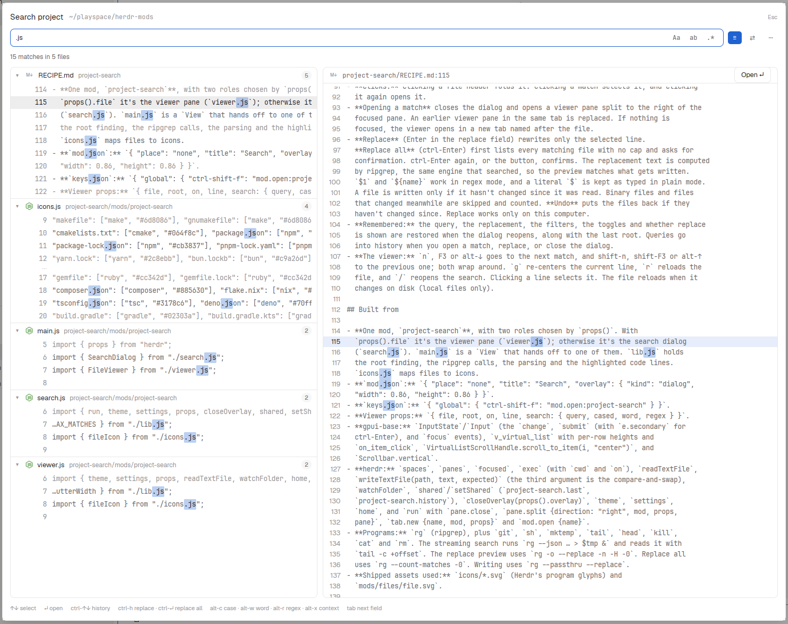

# herdr-mods

Mods for the [Herdr](https://herdr.dev) desktop app.

## project-search

Zed-style project search and replace, powered by ripgrep. Press `ctrl-shift-f` to search
the focused terminal's git repo. Matches stream in grouped by file with a live preview,
and Enter opens the selected match in a viewer pane beside your shell. Replace mode shows
every change inline before it's written, and you can undo it.



- Match case, whole word and regex, with optional context lines.
- Include and exclude globs, and an option to search ignored and hidden files.
- Replace one line or all matches, with `$1` and `${name}` groups in regex mode, and Undo.
- Remembers the last search and keeps a history (`ctrl-↑`/`ctrl-↓`).
- Works in spaces on other machines (search only).

**Requires** [ripgrep](https://github.com/BurntSushi/ripgrep) (`rg`) on each machine you
search.

**Install:** ask your Herdr agent:

> Add https://herdr.dev/mods/andre0xFF/project-search

The agent copies `project-search/mods/project-search/` into `~/.config/herdr-app/mods/`
and merges `project-search/keys.json` into your keys. To install by hand, do the same
yourself.

[RECIPE.md](project-search/RECIPE.md) describes the mod in enough detail for an agent to
rebuild it from scratch.

## Layout

Each mod is a folder in the format [herdr.dev/mods](https://herdr.dev/mods/) expects:

```
<mod>/
├── RECIPE.md        the brief to build it from
├── preview.png
├── keys.json        keys it expects, merged into yours
└── mods/<mod>/      the mod itself
```
