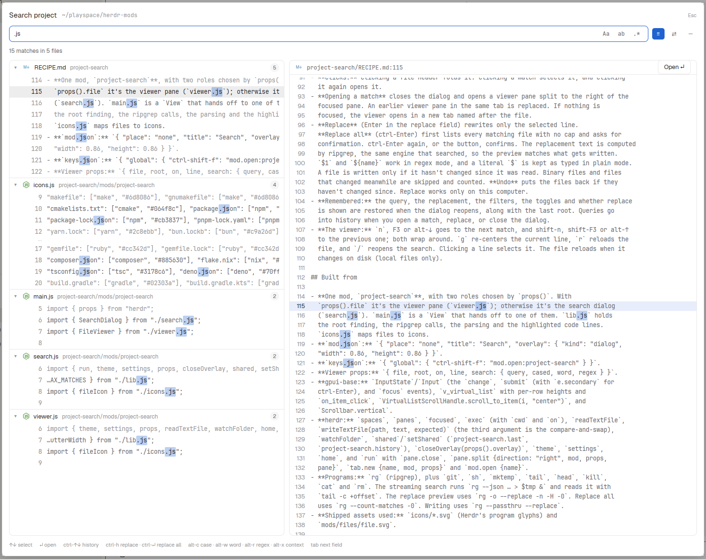

# Project search

Zed-style search and replace across the whole project. `ctrl-shift-f` opens a large
dialog: type a query and every match in the focused terminal's git repo streams in on
the left, grouped by file with a line of context around each match. On the right is
the selected match's file, scrolled to the match. Enter opens the match in a viewer pane
beside your shell. Replace mode shows each change inline before you make it, and you can
undo it.

## What you see

**The dialog** is an overlay that fills 86% × 86% of the window. It has 14px padding and
10px gaps, on the theme's `popover` background.

1. **Header row:** "Search project" (15px, semibold), then the folder being searched in
   the terminal font, dim, truncated, with `~` for home and `machine:` before it for a
   space on another machine. "Esc" sits dim at the right. Before the root is known it
   reads "finding the project…".
2. **Query row:** a 34px input (rounded 8, 1px border, the border turns `accent` while
   focused) with the placeholder "Search project…". Inside it on the right are three
   toggles: `Aa` match case, `ab` whole word, `.*` regex. Outside it are three more:
   `≡` context lines, `⇄` replace, `⋯` filters. Toggles are 24px high, at least 26px
   wide, rounded 5, in the terminal font. An enabled toggle is filled with `accent` and
   uses `accent_foreground` text. A disabled one is `muted` and gets a `hover` background.
   Each toggle has a tooltip that names its key.
3. **Replace row** (when `⇄` is on): an input with the placeholder "Replace with… ($1 for
   groups in regex mode)", then **Replace**, a 30px outlined button, and
   **Replace all**, a 30px button filled with `solid`. Both are dimmed while unavailable.
4. **Filters row** (when `⋯` is on): "Include: src/**, *.ts" and "Exclude: *.lock,
   dist/**" inputs, which take comma-separated globs, and an `ignored & hidden` toggle.
5. **Confirm bar** (after asking for Replace all): `blocked` at 12% opacity with a 50%
   `blocked` border. It reads "Replace N matches of “q” with “r” in M files?" and has
   **Cancel** and **Replace all  ctrl-↵** buttons.
6. **Status line** (18px, 12px text): "Searching…", "N matches in M files so far…",
   "No matches", "N matches in M files", or "N+ … · showing the first 5000" when capped.
   Errors appear in `blocked`, for example "Invalid regex: …" or "ripgrep (rg) isn't
   installed". After a replace it shows a note such as "Replaced 3 matches in 2 files"
   and an `accent` **Undo** link.
7. **Body:** two bordered panels with rounded 8 corners on the `background` color.
   - **Results** (left, 2/5 of the width) is a virtual list. A file header row is 30px on
     `surface` and shows a ▾/▸ fold marker, the file icon, the name (13px, semibold),
     the folder (dim, truncated) and a pill with the match count (`raised`, 11px). Line
     rows are 24px in the terminal font at 12.5px and show a right-aligned line number,
     then the text. Matches are bright (`muted`) and context lines are `dim`. The
     selected row is `selected`. A run's common indent is trimmed. If a match starts more
     than 60 characters in, the line is cut with "…" so the match shows. Separate runs
     in one file get a 12px "⋯" gap row. Matches are highlighted with `accent` at 30%
     and rounded 2. In replace mode each match is struck through on `blocked` at 20%,
     followed by its replacement on `working` at 20%.
   - **Preview** (right) has a 30px header with the file icon, `path:line` and an
     **Open ↵** button. Below it is the whole file as 20px lines with a line-number
     gutter. The match line is tinted with `selection` at 50%, and every match in the
     file is highlighted. When nothing is selected it reads "Type to search every file
     in the project."
8. **Hint row** (11px, dim): "↑↓ select · ↵ open · ctrl-↑↓ history · ctrl-h replace ·
   ctrl-↵ replace all · alt-c case · alt-w word · alt-r regex · alt-x context · tab next
   field".

**The viewer pane** opens beside the shell. It has a 30px header on `surface` with the
file icon, the full path and line, "k of N" and ↑/↓ buttons. Below the header is the
file, built from the same code lines as the preview.

**File icons** are Herdr's own program glyphs (`icons/<name>.svg`) in each language's
color, for example Python `#3776ab`, Go `#00add8`, TS `#3178c6` and Docker `#2496ed`.
Files without a glyph get a small lettered badge, such as `{}` JSON `#cbcb41`, `M↓`
Markdown `#519aba` or `Y` YAML `#cb171e`. Unknown files get the Files panel's plain
page icon.

## How it behaves

- **Where it searches:** the focused terminal's current folder, moved up to its git root
  (`git rev-parse --show-toplevel`). If no terminal is focused, it uses the last root used
  in the same space, then the space's folder, then home. Spaces on other machines are
  searched on that machine.
- **Searching** starts 160ms after you stop typing. On this machine ripgrep runs in the
  background and results stream in: the list fills while rg is still walking the repo,
  polled every 30ms at first and backing off to 250ms. A newer query kills the older rg.
  On another machine it runs a single search and shows the results when they're done.
  Each file shows at most 200 matches, and the total stops at 5000.
- **Options:** match case, whole word, regex, and context (±1 line, on by default).
  `ignored & hidden` searches `.gitignore`d and hidden files. Include and exclude take
  comma-separated globs. Files larger than 1MB are skipped and lines are cut at 400
  columns.
- **Keys in the dialog:** ↑/↓ or ctrl-p/ctrl-n move between matches and wrap around.
  PageUp/PageDown move 10. Enter opens. ctrl-↑/↓ cycle through the last 40 queries.
  alt-c / alt-w / alt-r / alt-x / alt-i toggle case, word, regex, context and ignored.
  ctrl-h shows or hides replace, and alt-f shows or hides the filters. tab and shift-tab
  move between the visible fields. Esc closes the confirm bar, or else closes the dialog.
- **Clicks:** clicking a file header folds it. Clicking a match selects it, and clicking
  it again opens it.
- **Opening a match** closes the dialog and opens a viewer pane split to the right of the
  focused pane. An earlier viewer pane in the same tab is replaced. If nothing is
  focused, the viewer opens in a new tab named after the file.
- **Replace** (Enter in the replace field) rewrites only the selected line.
  **Replace all** (ctrl-Enter) first lists every matching file with no cap and asks for
  confirmation. ctrl-Enter again, or the button, confirms. The replacement text is computed
  by ripgrep, the same engine that searched, so the preview matches what gets written.
  `$1` and `${name}` work in regex mode, and a literal `$` is kept as typed in plain mode.
  A file is written only if it hasn't changed since it was read. Binary files and files
  that changed meanwhile are skipped and counted. **Undo** puts the files back if they
  haven't changed since. Replace works only on this computer.
- **Remembered:** the query, the replacement, the filters, the toggles and whether replace
  is shown are restored when the dialog reopens, along with the last root. Queries go
  into history when you open a match, replace, or close the dialog.
- **The viewer:** `n`, F3 or alt-↓ goes to the next match, and shift-n, shift-F3 or alt-↑
  to the previous one; both wrap around. `g` re-centers the current line, `r` reloads the
  file, and `/` reopens the search. Clicking a line selects it. The file reloads when it
  changes on disk (local files only).

## Built from

- **One mod, `project-search`**, with two roles chosen by `props()`. With
  `props().file` it's the viewer pane (`viewer.js`); otherwise it's the search dialog
  (`search.js`). `main.js` is a `View` that hands off to one of them. `lib.js` holds
  the root finding, the ripgrep calls, the parsing and the highlighted code lines.
  `icons.js` maps files to icons.
- **`mod.json`:** `{ "place": "none", "title": "Search", "overlay": { "kind": "dialog",
  "width": 0.86, "height": 0.86 } }`.
- **`keys.json`:** `{ "global": { "ctrl-shift-f": "mod.open:project-search" } }`.
- **Viewer props:** `{ file, root, on, line, search: { query, cased, word, regex } }`.
- **gpui-base:** `InputState`/`Input` (the `change`, `submit` (with `e.secondary` for
  ctrl-Enter), and `focus` events), `v_virtual_list` with per-row heights and
  `on_item_click`, `VirtualListScrollHandle.scroll_to_item(i, "center")`, and
  `Scrollbar.vertical`.
- **herdr:** `spaces`, `panes`, `focused`, `exec` (with `cwd` and `on`), `readTextFile`,
  `writeTextFile(path, text, expected)` (the third argument is the compare-and-swap),
  `watchFolder`, `shared`/`setShared` (`project-search.last`,
  `project-search.history`), `closeOverlay(props().overlay)`, `theme`, `settings`,
  `home`, and `run` with `pane.close`, `pane.split {direction: "right", mod, props,
  pane}`, `tab.new {name, mod, props}` and `mod.open {name}`.
- **Programs:** `rg` (ripgrep), plus `git`, `sh`, `mktemp`, `tail`, `head`, `kill`,
  `cat` and `rm`. The streaming search runs `rg --json … > $tmp &` and reads it with
  `tail -c +offset`. The replace preview uses `rg -o --replace -n -H -0`. Replace all
  uses `rg --count-matches -0`. Writing uses `rg --passthru --replace`.
- **Shipped assets used:** `icons/*.svg` (Herdr's program glyphs) and
  `mods/files/file.svg`.

## Watch out

- **Finding rg:** `exec` doesn't use a login shell, so a Homebrew-on-Linux `rg` isn't
  always on PATH. The mod tries `rg` first and then `/home/linuxbrew/.linuxbrew/bin`,
  `/opt/homebrew/bin`, `/usr/local/bin`, `/usr/bin`, `~/.cargo/bin`, `~/.local/bin` and
  the Nix profile. It caches what it finds per machine.
- **Offsets:** rg reports match offsets as UTF-8 bytes, and JS strings index UTF-16
  units, so convert them or highlights drift on non-ASCII lines. The streaming reader also
  has to count bytes for its `tail` offset and only parse up to the last full line.
- **Don't pass `--max-columns` when replacing:** it would blank long lines in the file
  being written. Keep a file's missing final newline, because `--passthru` adds one.
- **Highlighting:** lines rg reported use rg's own ranges. Only the extra lines in the
  preview and viewer use a JS `RegExp` copy of the query, and if JS can't compile the
  pattern, those lines simply aren't highlighted.
- **Capping:** pipe the one-shot rg through `head -n 12000` so a huge result set stops
  rg instead of filling memory. Kill the background rg when the query changes, the dialog
  closes or the cap is reached, and remove its temp files.
- **ctrl-Enter** can arrive both as `submit` with `secondary` and as a key, depending on
  the input. Ignore a repeat within 250ms.
- The input needs a second `focus()` 300ms after opening. Otherwise the overlay steals
  focus.
- Requires `rg` on every machine you search. Replace is turned off on other machines.

## Done when

- `ctrl-shift-f` opens the dialog focused on the query, showing the current repo's root.
- Typing a word lists matches grouped by file, with counts, ±1 context line and "⋯"
  between runs. The count grows while a big repo is still being searched.
- ↑/↓ moves the selection, and the preview scrolls to the selected match with the line
  tinted.
- `Aa`, `ab`, `.*`, `≡` and the filters change the results. An invalid regex shows
  "Invalid regex: …".
- Enter opens a viewer pane to the right with the match line marked. `n` and shift-n step
  through matches, and editing the file elsewhere reloads the viewer.
- With replace on, every match shows struck through and followed by its replacement.
  Replace changes only the selected line. Replace all asks for confirmation, writes every
  file, and Undo restores them.
- Closing and reopening the dialog restores the last query and options, and ctrl-↑ recalls
  earlier queries.
- `herdr-app check` passes for the mod.
